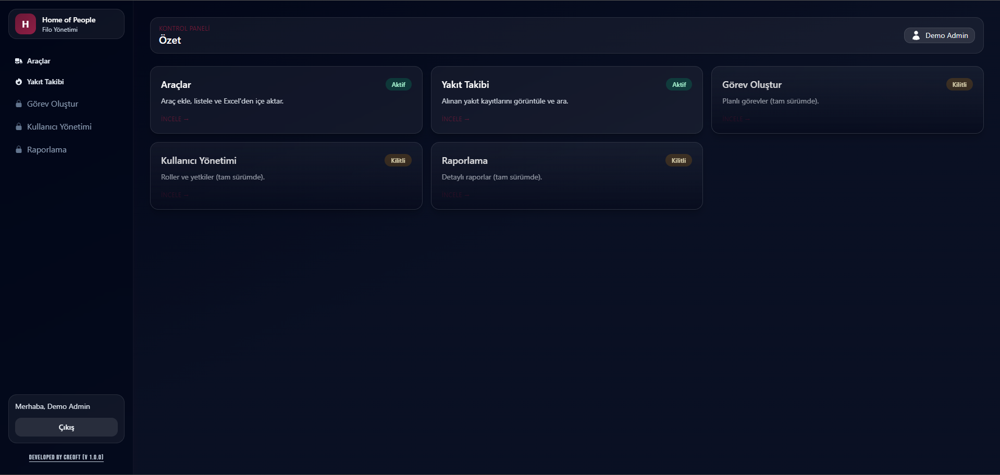
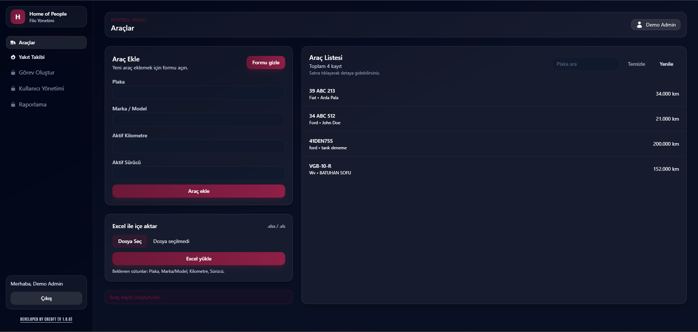
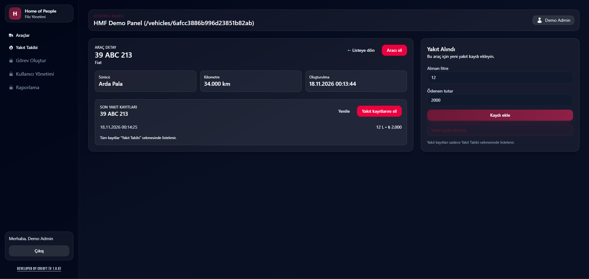
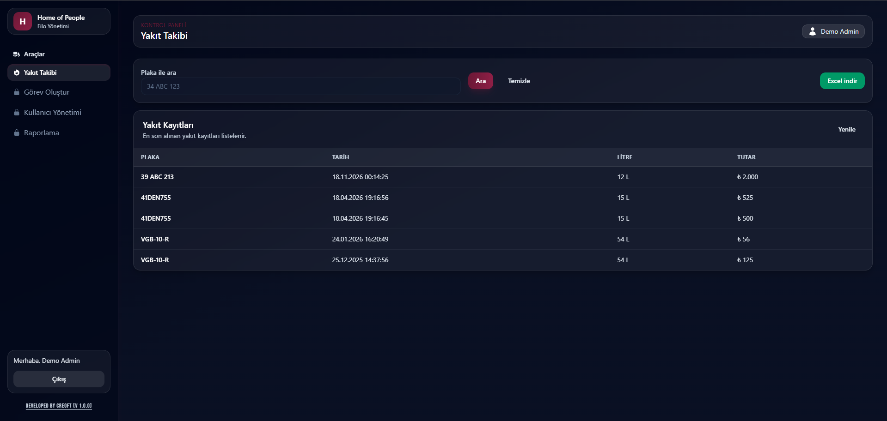

# Plate Fuel Tracker

A modern fleet and fuel management panel built with **Next.js 16**, **TypeScript**, and **MongoDB**.

Plate Fuel Tracker is a web-based application for managing vehicle records, monitoring fuel activity, and handling fleet data through a clean and responsive dashboard.

---

## Screenshots

### Dashboard overview

Active modules (Vehicles, Fuel Tracking) and locked features reserved for the full version.



### Vehicles

Add vehicles manually, import from Excel (`.xlsx` / `.xls`), and search the list by license plate.



### Vehicle detail

Driver, odometer, and creation info, plus recent fuel entries and a form to add new fuel records.



### Fuel tracking

Central fuel activity table with plate search and Excel export.



---

## Features

### Fleet Management
- Create and manage vehicle records.
- Track license plates, make and model, odometer readings, and assigned drivers.
- Search vehicles by license plate.
- Import vehicle records from Excel spreadsheets (`.xlsx` and `.xls`).
- Validate imported data before database operations.

### Fuel Tracking
- Record fuel transactions for vehicles.
- Track fuel volume, transaction amounts, and dates.
- Browse fuel activity from a centralized dashboard.
- Export fuel records to Excel.
- Export by today, last 7 days, last month, or a custom date range.

### Authentication & Security
- JWT-based session management.
- HttpOnly authentication cookies.
- Password hashing with bcrypt.
- Role-based authorization (`super_admin`, `admin`, `user`).
- Protected application routes and API endpoints.
- Server-side input validation.
- Centralized API error handling.
- Environment variable validation.
- File upload restrictions and Excel archive safety checks.
- Progressive login backoff and bcrypt concurrency limits.
- Session invalidation after password reset (`passwordChangedAt` + JWT `iat`).

### Interface
- Responsive dashboard layout.
- Dark and light themes.
- Clean vehicle and fuel management screens.

## Technology Stack

| Technology | Purpose |
|---|---|
| Next.js 16 | Application framework |
| React 19 | User interface |
| TypeScript | Type safety |
| Tailwind CSS v4 | Styling |
| MongoDB | Database |
| Mongoose | Database modeling |
| JWT | Authentication |
| bcryptjs | Password hashing |
| SheetJS (xlsx) | Excel import and export |
| ESLint | Code quality |

## Getting Started

### Prerequisites

- Node.js
- npm
- MongoDB instance (local or MongoDB Atlas)

### 1. Clone the repository

```bash
git clone https://github.com/palaarda/plate-fuel-tracker-demoversion-next-16.0.10.git
cd plate-fuel-tracker-demoversion-next-16.0.10
```

### 2. Install dependencies

```bash
npm install
```

### 3. Configure environment variables

Copy `.env.example` to `.env.local` and fill in the values:

```bash
cp .env.example .env.local
```

```env
MONGODB_URI=mongodb+srv://<username>:<password>@<cluster-url>/
MONGODB_DB=hmf2
JWT_SECRET=YOUR_RANDOM_SECRET_AT_LEAST_32_CHARACTERS
TRUSTED_PROXY_HOPS=0
ADMIN_USERNAME=your_admin_username
ADMIN_PASSWORD=your_strong_admin_password
ADMIN_NAME=Administrator
```

Generate a secure JWT secret with Node.js:

```bash
node -e "console.log(require('crypto').randomBytes(48).toString('base64url'))"
```

**Important:**
- Never commit `.env.local` or expose database credentials.
- Use a unique, randomly generated JWT secret.
- Use a strong administrator password (min. 12 characters, at least 3 character classes).
- `MONGODB_DB` defaults to `hmf2` if not specified.
- The app never creates a default admin account automatically.

### 4. Create the administrator account

```bash
npm run admin:create
```

This creates a `super_admin` account if the specified username does not already exist.

To reset an existing administrator's password:

```bash
node scripts/ensure-admin.js --reset-password
```

After creating the administrator account, the `ADMIN_PASSWORD` environment variable can be removed if it is no longer needed.

### 5. Start the development server

```bash
npm run dev
```

Open [http://localhost:3000](http://localhost:3000) in your browser.

If you use MongoDB Atlas, make sure your current IP is allowed under **Network Access**.

## Available Scripts

| Command | Description |
|---|---|
| `npm run dev` | Start the development server |
| `npm run build` | Create a production build |
| `npm run start` | Start the production server |
| `npm run lint` | Run ESLint |
| `npm run admin:create` | Create the administrator account |

TypeScript can also be checked with:

```bash
npx tsc --noEmit
```

## Project Structure

```text
plate-fuel-tracker/
├── screenshots/
├── scripts/
│   ├── ensure-admin.js
│   ├── init-db.js
│   └── seed-demo.js
├── src/
│   ├── app/
│   │   ├── api/
│   │   ├── auth/
│   │   └── (dashboard)/
│   ├── components/
│   ├── lib/
│   ├── models/
│   └── proxy.ts
├── .gitignore
├── package.json
├── next.config.ts
└── tsconfig.json
```

## Current Project Scope

Plate Fuel Tracker is currently a demo-stage project.

The active modules are:
- Vehicle management
- Fuel tracking
- Excel import and export
- Authentication and authorization

The following dashboard sections are reserved for future development:
- Task management
- User management interface
- Advanced reporting

## Security Notes

This project includes several application-level security measures, but it has not been independently audited or penetration-tested.

Before deploying:
- Configure production environment variables securely.
- Use HTTPS.
- Protect database access with appropriate network restrictions and credentials.
- Keep dependencies updated.
- Never publish secrets, tokens, or private configuration files.

## License

No license has been specified yet. All rights reserved unless otherwise stated.

---
